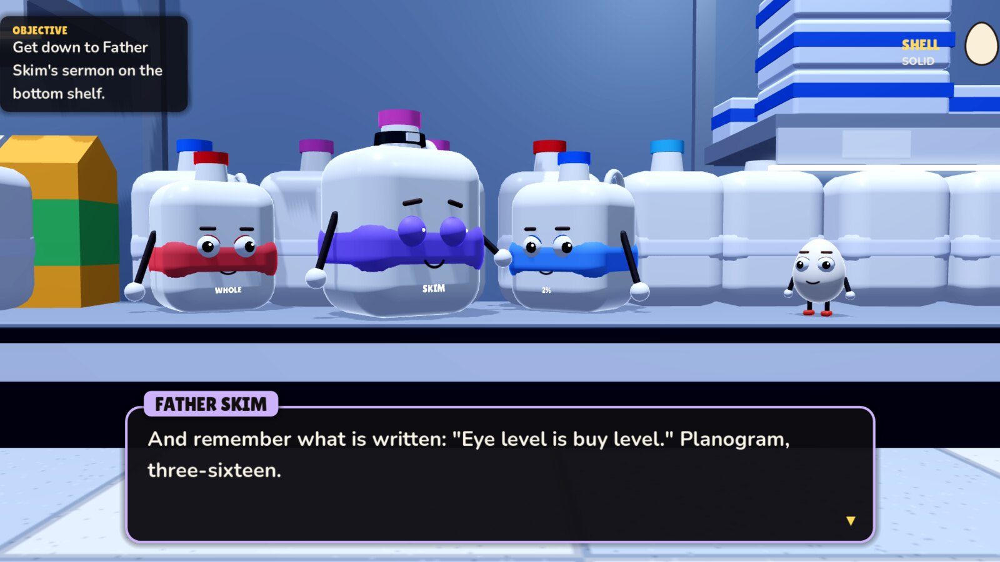

**Shelf Life** is an R-rated comedy platformer set in a supermarket after closing. You play Baker, the thirteenth egg in a carton of twelve: no cup, no slot, and no place in the Planogram, the sacred shelf layout the food of Grocerama worships. The new Planogram arrives at dawn, and Baker has one night to cross the store and find out if there's room in it for a packing error. Two acts are playable, about 35 minutes together.

> **Content:** strong language, crude humor, religious satire and food in mortal peril.

### Downloads

| System | File | How to start it |
|---|---|---|
| Windows 10 or 11 (64-bit) | `ShelfLife-windows-x86_64.zip` ({{WINDOWS_SIZE}}) | Unzip it and run `ShelfLife.exe`. Keep `ShelfLife.pck` in the same folder. The game isn't code-signed, so SmartScreen may warn you the first time: choose **More info → Run anyway**. |
| Linux (x86-64) | `ShelfLife-linux-x86_64.zip` ({{LINUX_SIZE}}) | Unzip it and run `./ShelfLife.x86_64`. If it won't start, run `chmod +x ShelfLife.x86_64` first. Keep `ShelfLife.pck` in the same folder. |

You don't need the other files: `manifest.json` and the two `shelflife-{{VERSION}}-*.pck` files are for the in-game updater. `SHA256SUMS.txt` lists a checksum for every file.

### Updating

Installed copies update themselves. When a new version is out, the title screen shows **Update to v…**. Press it, and the game downloads the update (usually under a megabyte), checks it and restarts on the new version. Saves and settings carry over. The game checks GitHub each time it starts. To turn that off, go to **Settings → Check for updates**.

### Controls

| | Keyboard | Gamepad |
|---|---|---|
| Move | A / D or ← / → | Left stick / D-pad |
| Jump (hold for higher) | Space, W or ↑ | A |
| Talk / advance dialogue | E or Enter (Space advances too; hold it to fast-forward) | X / A |
| Pause | Esc | Start |

Eggs crack. A short drop is fine, and so is hopping off a crate, but jump or fall off anything tall and you'll crack your shell. Three cracks and you're done. Bread and other soft things are safe to land on. Once you finish Act One, the title screen can start either act.

### Changes in {{VERSION}}

{{CHANGES}}

### Credits

Everything in the game is generated in code: the characters, props and faces, plus the voices, sound effects and store muzak. Fonts: [Lilita One](https://fonts.google.com/specimen/Lilita+One) by Juan Montoreano and [Nunito](https://fonts.google.com/specimen/Nunito) by Vernon Adams, under the SIL Open Font License. Made with the [Godot Engine](https://godotengine.org). `NOTICES.txt` in each zip has the full licenses.
