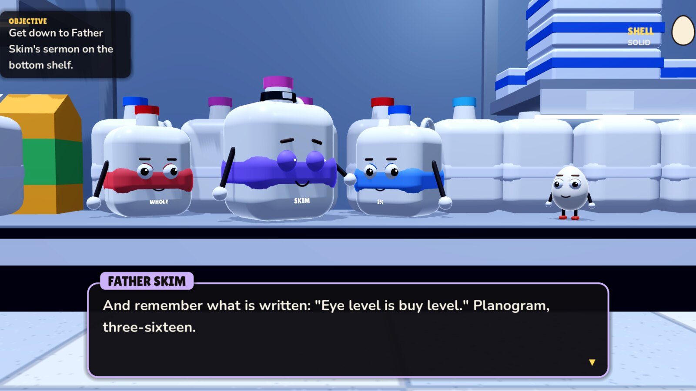
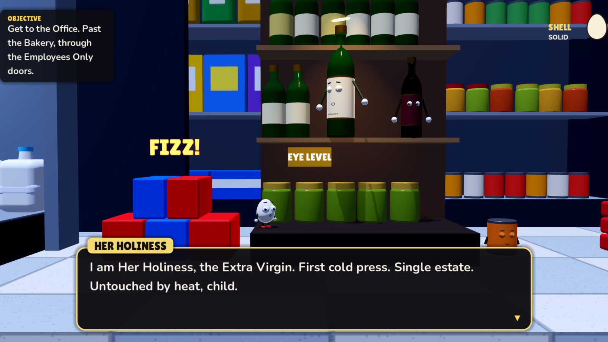
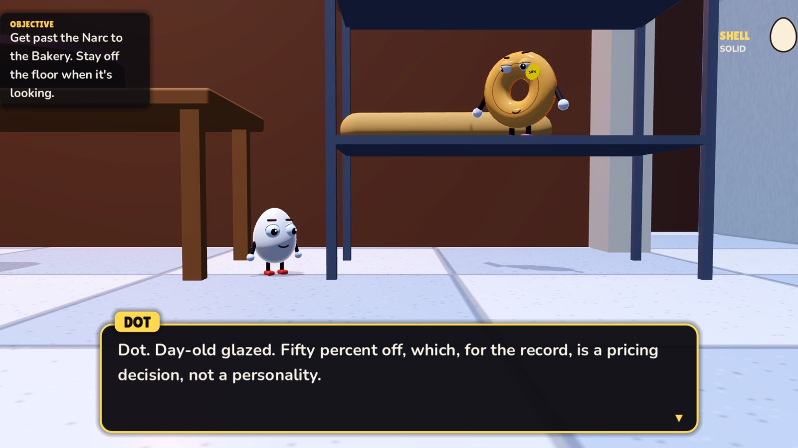
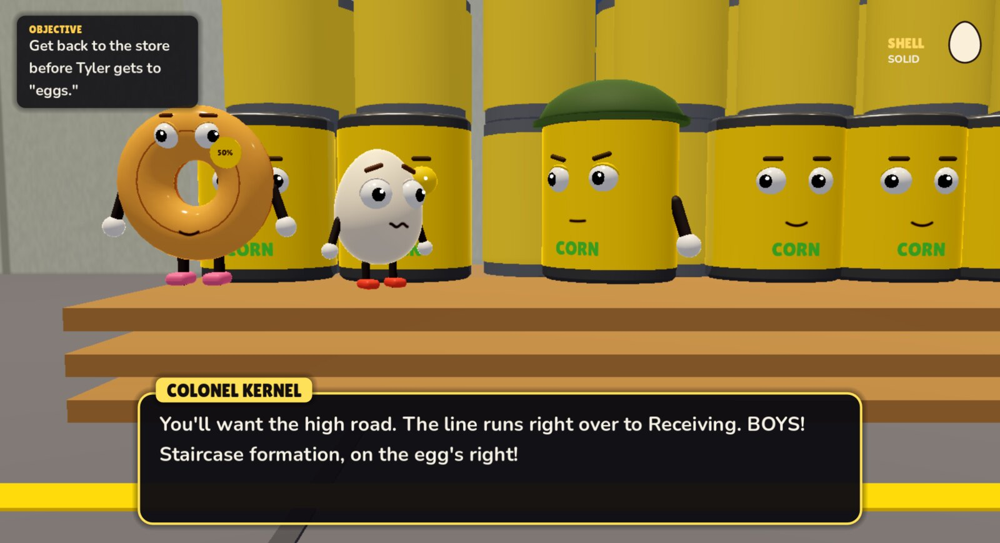
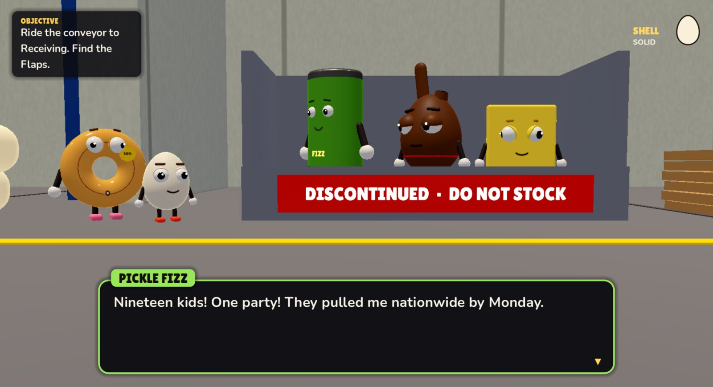

# Shelf Life

An R-rated grocery store comedy. A 2.5D story platformer about Baker, the
thirteenth egg in a carton of twelve: no cup, no slot, and no place in the
Planogram, the sacred shelf layout the food of Grocerama worships.

The faithful believe that when you're **Chosen** (bought) and hear **the Beep**
(scanned), you come back at the next **Restock**, same shelf, forever. Tonight
is the night before the store's Grand Re-Opening, when a new Planogram arrives
and everyone gets an eternal Facing. Baker sets out across the store at night
to find out if there's a place in it for a packing error.

It does not go well for anyone's faith.

> **Content:** strong language, crude humor, religious satire and food in mortal peril.



## Download

Get the latest version from the **[releases page](https://github.com/GPTmadeit/shelflife/releases/latest)**:

| System | File | How to start it |
|---|---|---|
| Windows 10 or 11 (64-bit) | [`ShelfLife-windows-x86_64.zip`](https://github.com/GPTmadeit/shelflife/releases/latest/download/ShelfLife-windows-x86_64.zip) | Unzip it and run `ShelfLife.exe`. SmartScreen may warn you because the game isn't code-signed: choose **More info → Run anyway**. |
| Linux (x86-64) | [`ShelfLife-linux-x86_64.zip`](https://github.com/GPTmadeit/shelflife/releases/latest/download/ShelfLife-linux-x86_64.zip) | Unzip it and run `./ShelfLife.x86_64` (`chmod +x` it first if needed). |

Keep `ShelfLife.pck` next to the program: it's the game itself.

### Updates

Installed copies update themselves. When a new version is out, the title screen offers **Update to v…**. Press it, and the game downloads the new version, checks it against the release's SHA-256 sums, swaps the files and restarts. A normal update is under a megabyte, because only `ShelfLife.pck` changes. The program itself is only replaced when a release moves to a new engine. Saves and settings carry over.

The update check is a single request to github.com when the game starts, and it sends nothing but a `ShelfLife/<version>` user agent. Turn it off with **Settings → Check for updates**.

| | |
|---|---|
|  |  |

## Status

Two acts are playable start to finish, about 35 minutes together.

- **Act One: Unplanned.** The dairy case, the main aisle and the Narc, the
  bakery, and the Employees Only doors.
- **Act Two: Discontinued.** The Back: the breakroom floor, the stockroom and
  its mousetraps, Pallet Nine, and Receiving, where the Baler eats whatever
  isn't on the Planogram.

Act Three is not written yet.

| | |
|---|---|
|  |  |

## Play

Download a release (above), or run it from source with [Godot 4.7](https://godotengine.org):

```sh
godot --path .
```

| | Keyboard | Gamepad |
|---|---|---|
| Move | A / D or ← / → | Left stick / D-pad |
| Jump (hold for higher) | Space, W or ↑ | A |
| Talk / advance dialogue | E or Enter (Space advances too; hold it to fast-forward) | X / A |
| Whistle for Dot (once she's with you) | Q or F | Y |
| Pause | Esc | Start |

Eggs crack. A short drop is fine, and so is hopping off a crate; jump or fall
off anything tall and you'll crack your shell. Three cracks and you're done.
Bread and other soft things are safe to land on.

Once Dot is with you, whistle and she lies down for you: a springboard on
flat ground, and a soft landing at the bottom of a drop.

The pause menu keeps every Planogram scrap you've found, to read again. Once
you finish Act One, the title screen can replay either act from its start.

Graphics quality (Settings) defaults to Low on older Intel integrated GPUs.

## How it's made

Everything is generated in code at startup: every character, prop and shelf
is built from procedural meshes (`scripts/gfx/meshes.gd`), faces are drawn from
distance functions (`scripts/gfx/face_tex.gd`), and every sound, voice blip and
the store muzak is synthesized (`scripts/core/synth.gd`). No audio or texture
files ship with the game except two fonts.

| Path | What |
|---|---|
| `dialogue/act1.dlg`, `act2.dlg` | the script of each act (format in `scripts/dialogue/dlg_parser.gd`) |
| `scripts/world/level.gd` | what the acts share: player, camera, triggers, hazards, scraps, respawn |
| `scripts/world/act1.gd`, `act2.gd` | each act's level: layout, cast, triggers, cutscene events |
| `scripts/actors/` | Baker (`player.gd`), the food characters (`food_rig.gd`), the Narc, the humans |
| `scripts/ui/` | dialogue box, HUD, title, pause and settings |

### Dev tools

```sh
godot --headless --path . --script tests/check.gd   # scripts compile, dialogue is consistent
tests/shot.sh out.png 8 --cp narc --flags intro_done,sermon_done   # screenshot (Hyprland, hidden workspace)
```

Flags after `--`: `--level <act>`, `--cp <checkpoint>`, `--at <x,y>`, `--flags a,b`, `--dlg <node>`, `--auto`
(reads dialogue by itself), `--bot` (walks right and hops), `--godmode`,
`--quality 0|1|2`, `--act action@t0-t1,...`, `--shot <png> <s>`, `--burst <n> <step>`, `--trace`,
`--end-quit` (quit when the act ends). A whole act plays itself with
`--level 2 --cp start --auto --bot --godmode --end-quit`. The updater has its own test flags (see `scripts/core/updater.gd`).

### Releasing

```sh
tools/set_version.sh 0.2.0      # bump scripts/core/version.gd and project.godot
# add a "## 0.2.0 (date)" section to CHANGELOG.md: it becomes the release notes
git commit -am "..." && git push
gh workflow run release.yml --ref main   # or push a v0.2.0 tag
```

The [release workflow](.github/workflows/release.yml) checks the scripts and dialogue, then exports Linux
and Windows builds with `tools/package.sh`. The exported game has to play both acts by itself. Then
`tools/update_test.sh` updates a fresh install from a fake 0.0.0 to the new build, on Linux and on Windows,
for both the game-file update and the full engine update. Only then is the release published. Afterwards,
the same update runs once more against the published release on GitHub.

`tools/package.sh` also works locally (it needs Godot's export templates). It writes the zips, the
updater's `.pck` files, `manifest.json` and `SHA256SUMS.txt` into `dist/`.

## Credits

Fonts: [Lilita One](https://fonts.google.com/specimen/Lilita+One) by Juan Montoreano and
[Nunito](https://fonts.google.com/specimen/Nunito) by Vernon Adams, both under the SIL Open
Font License (see `assets/fonts/`). Built with the [Godot Engine](https://godotengine.org); each release
zip includes `NOTICES.txt` with the engine's license and third-party notices.
